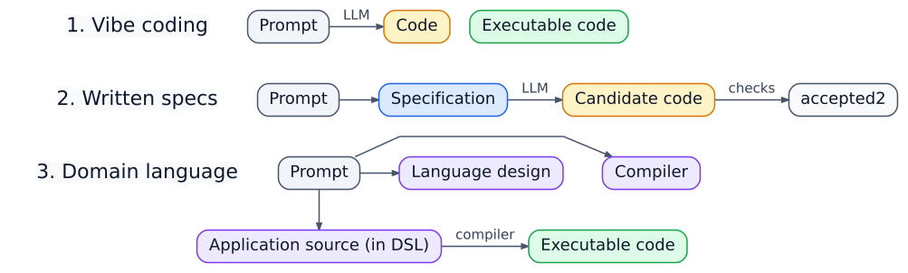

class: center, middle

# The Three Stages of LLM Coding

**From vibe coding to domain-specific languages**

Steve Traugott

*CSWG Workshop — October 29, 2026*

[Slides](https://ciwg.github.io/workshop-2026-10-29-grid-languages/) · [Repository](https://github.com/ciwg/workshop-2026-10-29-grid-languages/)

???
The central question is not whether to use LLMs. We already do. The question is where we place the nondeterministic boundary, what artifact becomes authoritative, and what can be checked mechanically afterward.

---

## The progression

A Domain Specific Language (DSL) is a language designed to write code
for a particular problem domain -- it tends to have  syntax and
semantics that are optimized for the problem at hand, and allows for
more concise and expressive code than a general-purpose language.

.center[]

???
Each stage keeps the useful parts of the earlier stage and makes a stronger artifact authoritative. This is a progression, not a maturity ranking. Stage 1 is often the right way to explore. Stage 2 gives us an independent statement of intent. Stage 3 makes the accepted specification executable through a conventional compiler boundary.

---

class: center, middle

# Stage 1

## The code is the specification

---

## Vibe coding

<figure class="diagram" role="group" aria-label="Conversation and examples pass through an LLM to produce working code, which becomes the only authoritative artifact.">
  <div class="flow-row">
    <div class="node neutral wide">Conversation<br>+ examples</div>
    <div class="arrow llm-arrow" aria-hidden="true">⇢<small>prompt</small></div>
    <div class="node llm">LLM</div>
    <div class="arrow llm-arrow" aria-hidden="true">⇢<small>generates</small></div>
    <div class="node artifact authoritative wide">Working code<br><small>the specification</small></div>
  </div>
</figure>

- Extremely fast path from idea to experiment
- Excellent for discovery and disposable prototypes
- The generated code contains details that were never stated elsewhere
- Review means reconstructing intent from code and conversation

???
“The code is the spec” does not mean the code is bad. It means there is no more authoritative, independently checkable description of what it should do. Tests help, but unless their intent is written down, the tests are also part of the generated implementation bundle.

---

## Stage 1 is useful

Use it when:

- the problem is still being discovered;
- failure is cheap and reversible;
- a human can inspect the entire result;
- the artifact is short-lived; or
- speed matters more than repeatable regeneration.

--

Move on when maintenance, audit, safety, or multiple implementations matter.

---

class: center, middle

# Stage 2

## Written specifications are authoritative

---

## Specification-directed coding

<figure class="diagram" role="group" aria-label="An authoritative specification is interpreted by an LLM into candidate code, which becomes accepted code only after checks.">
  <div class="flow-row">
    <div class="node spec authoritative wide">Markdown · diagrams<br>schemas · examples<br><small>authoritative specification</small></div>
    <div class="arrow llm-arrow" aria-hidden="true">⇢<small>LLM interprets</small></div>
    <div class="node candidate wide">Candidate code</div>
    <div class="arrow check-arrow" aria-hidden="true">→<small>static checks + tests</small></div>
    <div class="node accepted authoritative wide">Accepted code</div>
  </div>
</figure>

The code should reflect the specification.

The specification can be reviewed without reading every implementation detail.

???
The generation step is still nondeterministic, so generated code is a candidate until it passes checks. A strong setup validates both the specification itself and the implementation's conformance to it.

---

## What Stage 2 adds

- A durable statement of logic, data, behavior, and constraints
- Specification linting: completeness, consistency, references, identifiers
- Implementation conformance tests
- The option to compare several independent implementations
- A basis for visualization, documentation, and regeneration

--

But natural-language meaning is still interpreted during each generation.

???
A Markdown spec can be precise, but prose rarely has a complete formal semantics. Two generators can make different choices while each appears reasonable. Conformance tests shrink that freedom; they do not automatically eliminate it.

---

## Why two LLM runs can differ

There are multiple sources of variation—GPU arithmetic is one and is easy to prove:

- Token sampling can choose among plausible continuations
- Prompts, retrieved context, and tool results can change
- Model versions and serving systems can change

<figure class="diagram" role="group" aria-label="GPU reduction order provides one demonstrable path from identical inputs to a changed token decision.">
  <div class="flow-row">
    <div class="node neutral wide">Same input<br>same weights</div>
    <div class="arrow" aria-hidden="true">→</div>
    <div class="node llm wide">Different GPU<br>addition order</div>
    <div class="arrow" aria-hidden="true">→</div>
    <div class="node risk wide">Different rounded<br>low bits</div>
    <div class="arrow risk-arrow" aria-hidden="true">→</div>
    <div class="node candidate wide">Threshold or token<br>can change</div>
  </div>
  <figcaption>Interactive demonstration: <a href="https://floatlab.pplx.app/">Float Lab — IEEE 754 explorer</a></figcaption>
</figure>

???
Temperature zero does not by itself promise a stable result across model versions, serving stacks, hardware, or changing context. Conversely, GPUs are capable of deterministic computations when the algorithms, operation order, inputs, software, and hardware behavior are controlled.

---

## A floating-point number

Conceptually, a binary floating-point value has:

<figure class="diagram" role="group" aria-label="A floating-point value divides a finite bit budget among a sign, exponent, and significand.">
  <div class="bit-field">
    <span class="bit-sign">sign<br><small>±</small></span>
    <span class="bit-exponent">exponent<br><small>scale</small></span>
    <span class="bit-significand">significand<br><small>significant binary digits</small></span>
  </div>
  <div class="formula">sign × significand × 2<sup>exponent</sup></div>
</figure>

The bit budget is finite.

- The **sign** chooses positive or negative
- The **significand** carries the significant binary digits
- The **exponent** scales those digits
- Rounding chooses a representable result when the exact result does not fit

???
IEEE 754 also specifies signed zero, infinities, NaNs, subnormal numbers, rounding modes, and required operations. This slide is only the compact mental model needed for the addition example.

---

## Adding floating-point numbers

To add values with different exponents:

<figure class="diagram" role="group" aria-label="Floating-point addition aligns exponents, shifts the smaller significand, adds, then normalizes and rounds.">
  <div class="flow-row">
    <div class="node spec"><strong>1</strong><br>Align exponents</div>
    <div class="arrow" aria-hidden="true">→</div>
    <div class="node llm"><strong>2</strong><br>Shift smaller<br>significand</div>
    <div class="arrow" aria-hidden="true">→</div>
    <div class="node spec"><strong>3</strong><br>Add<br>significands</div>
    <div class="arrow risk-arrow" aria-hidden="true">→</div>
    <div class="node artifact"><strong>4</strong><br>Normalize<br>and round</div>
  </div>
  <div class="formula" style="margin-top:0.7em">1.001010… <span class="muted-text">+ 0.000001…</span> <span class="rounding-loss">→ lost low bits</span></div>
</figure>

--

Bits shifted beyond the available precision can be lost.

That makes the order of a long computation matter.

---

## Addition is not associative

With finite precision, this can happen:

```text
(a + b) + c  !=  a + (b + c)
```

For example, with limited precision:

```text
a =  1e20
b = -1e20
c =  3.14
```

One grouping preserves `3.14`; the other can round it away.

???
The important correction is about regrouping, not swapping two ordinary operands. Under normal IEEE round-to-nearest arithmetic, `a+b` and `b+a` generally produce the same finite result. Parallel reduction changes the grouping of many additions, which is where non-associativity becomes important.

---

## Parallel reductions

Sequential sum:

```text
(((a + b) + c) + d)
```

Parallel tree:

```text
(a + b) + (c + d)
```

Both implement a mathematical sum.

They may round differently.

--

Different reduction trees can produce different final bits without any hardware defect.

???
This can happen on CPUs too. GPUs make parallel reductions common because thousands of operations are scheduled together. Run-to-run nondeterminism requires something else to vary as well, such as scheduling, algorithm selection, atomics, or the implementation. A fixed parallel tree can be repeatable even though it differs from a sequential result.

---

## Small machines make a different trade

Many microcontrollers lack a hardware floating-point unit.

Then floating-point operations may become software routines that cost more:

- instructions;
- time;
- code space; and
- energy.

Embedded programs often use integers or fixed-point arithmetic when the required range and precision are known.

???
Avoiding floating point is not a universal rule. Some microcontrollers have capable floating-point hardware, and software floating point may be perfectly adequate at low rates. The engineering choice depends on required range, precision, performance, power, and the cost of conversion errors.

---

## Stage 2's remaining gap

<figure class="diagram" role="group" aria-label="The same written specification can produce two programs through separate LLM runs, and both can pass known tests while differing elsewhere.">
  <div class="node spec authoritative wide centered">Same written specification</div>
  <div class="arrow llm-arrow" aria-hidden="true">⇣<small>interpreted twice</small></div>
  <div class="compare columns-2">
    <div class="card llm"><div class="node llm">LLM A</div><div class="arrow" aria-hidden="true">↓</div><div class="node candidate">Program A</div><div class="node accepted compact">Known tests pass</div></div>
    <div class="card llm"><div class="node llm">LLM B</div><div class="arrow" aria-hidden="true">↓</div><div class="node candidate">Program B</div><div class="node accepted compact">Known tests pass</div></div>
  </div>
</figure>

Both programs may pass the known tests and still differ elsewhere.

--

Can the specification itself become executable?

---

class: center, middle

# Stage 3

## A domain language becomes the source code

---

## Move the LLM to design time

Use LLMs to help:

- design the domain-specific language;
- specify its grammar and semantics;
- implement its compiler and tools;
- generate tests and negative cases; and
- write or revise programs in the language.

--

Then use the accepted compiler for normal builds.

<figure class="diagram" role="group" aria-label="An accepted domain-language program passes through a deterministic compiler to produce an artifact without LLM interpretation during the normal build.">
  <div class="flow-row">
    <div class="node spec authoritative wide">Accepted DSL source</div>
    <div class="arrow compiler-arrow" aria-hidden="true">→<small>deterministic compiler</small></div>
    <div class="node artifact authoritative">Artifact</div>
  </div>
</figure>

???
The LLM does not disappear. It helps create and edit both language and programs. The important shift is that an ordinary build no longer asks an LLM to reinterpret the application's meaning.

---

## What “deterministic” promises

Given the same exact:

- source bytes;
- compiler and dependencies;
- configuration and target; and
- declared environment,

the compiler produces the same result or the same failure.

--

This does **not** prove that the language, compiler, or program is correct.

???
Deterministic translation and reproducible builds are related but distinct. Byte-for-byte reproducibility also requires control of timestamps, paths, toolchain versions, link order, environment variables, and other ambient inputs. A compiler should make those dependencies explicit or eliminate them.

---

## The compiler path

<figure class="diagram" role="group" aria-label="A compiler transforms domain source through parsing, a typed intermediate representation, verified lowering, and a target representation into an artifact.">
  <div class="flow-row">
    <div class="node spec authoritative">Domain source</div>
    <div class="arrow compiler-arrow" aria-hidden="true">→<small>parse + type-check</small></div>
    <div class="node compiler wide">Typed intermediate<br>representation</div>
    <div class="arrow compiler-arrow" aria-hidden="true">→<small>verified lowering</small></div>
    <div class="node compiler wide">Target<br>representation</div>
    <div class="arrow compiler-arrow" aria-hidden="true">→</div>
    <div class="node artifact authoritative">Executable artifact</div>
  </div>
</figure>

Each arrow should have:

- defined inputs and outputs;
- validation rules;
- positive and negative tests; and
- provenance sufficient to reproduce the build.

---

## Source code is not object code

A DSL compiler may emit:

| Output | What it is |
| --- | --- |
| Go, Rust, JavaScript | Generated source for another compiler or runtime |
| LLVM IR, WebAssembly | Lower-level portable representation |
| Native object code | Architecture-specific machine artifact |
| Grid assembly / image | Portable program for the Grid virtual machine |

The distinction matters when we say a build is complete or reproducible.

---

## Why use an intermediate representation?

An [intermediate representation](https://en.wikipedia.org/wiki/Intermediate_representation) gives multiple front ends and targets a shared boundary.

<figure class="diagram" role="group" aria-label="Several domain languages converge on a typed intermediate representation and share analysis and lowering to several targets.">
  <div class="flow-row">
    <div class="flow-column">
      <div class="node spec compact">DSL A</div>
      <div class="node spec compact">DSL B</div>
      <div class="node spec compact">DSL C</div>
    </div>
    <div class="arrow compiler-arrow" aria-hidden="true">→</div>
    <div class="node compiler authoritative wide">Typed IR<br><small>shared analysis + lowering</small></div>
    <div class="arrow compiler-arrow" aria-hidden="true">→</div>
    <div class="flow-column">
      <div class="node artifact compact">Go</div>
      <div class="node artifact compact">WebAssembly</div>
      <div class="node artifact compact">Grid assembly</div>
    </div>
  </div>
</figure>

It can preserve types, source locations, side effects, and invariants while making analysis and lowering reusable.

???
An abstract syntax tree is often source-shaped. An IR is shaped for analysis or transformation. There can be several IRs: a high-level domain IR, a lower control-flow IR, and a machine-oriented IR. Lowering too early can discard the vocabulary needed for useful diagnostics.

---

## LLVM and MLIR

<a href="https://en.wikipedia.org/wiki/LLVM">LLVM</a> provides reusable compiler components and a widely used lower-level IR and backend ecosystem.

<a href="https://mlir.llvm.org/">MLIR</a> provides infrastructure for multiple abstraction levels and extensible **dialects**.

<figure class="diagram" role="group" aria-label="MLIR carries programs through multiple dialect levels and can lower either into LLVM IR or another backend.">
  <div class="flow-row">
    <div class="node language">Domain dialect</div>
    <div class="arrow compiler-arrow" aria-hidden="true">→</div>
    <div class="node language">Shared dialects</div>
    <div class="arrow compiler-arrow" aria-hidden="true">→</div>
    <div class="node language">Target dialect</div>
    <div class="arrow compiler-arrow" aria-hidden="true">→</div>
    <div class="flow-column">
      <div class="node compiler compact">LLVM IR</div>
      <div class="node neutral compact">Another backend</div>
    </div>
  </div>
</figure>

MLIR is compiler infrastructure—not one universal source language.

???
MLIR is useful when a compiler needs to retain high-level tensor, workflow, hardware, or domain concepts before progressively lowering them. In machine-learning toolchains it compiles model computations, shapes, layouts, data movement, and kernels. Weights may travel as constants or data; saying that MLIR simply “compiles the weights and biases” hides the important distinction.

---

## A language tower

<figure class="diagram" role="group" aria-label="An application language lowers through domain, workflow, Grid machine, and assembly layers into a program image, with validation at every boundary.">
  <div class="tower-layout">
    <div class="stack">
      <div class="node spec authoritative wide">Application DSL</div>
      <div class="arrow check-arrow" aria-hidden="true">↓<small>validate</small></div>
      <div class="node language wide">Domain IR / lower-level DSL</div>
      <div class="arrow check-arrow" aria-hidden="true">↓<small>validate</small></div>
      <div class="node language wide">Shared workflow + promise operations</div>
      <div class="arrow check-arrow" aria-hidden="true">↓<small>validate</small></div>
      <div class="node compiler wide">Portable Grid machine operations</div>
      <div class="arrow check-arrow" aria-hidden="true">↓<small>validate</small></div>
      <div class="node compiler wide">Grid assembly</div>
      <div class="arrow check-arrow" aria-hidden="true">↓<small>validate</small></div>
      <div class="node artifact authoritative wide">Program image</div>
    </div>
    <ul class="diagram-notes">
      <li>Each level keeps the meaning needed at that level</li>
      <li>Each lowering step checks that its output is legal for the next level</li>
      <li>Several application languages can share lower layers</li>
      <li>New targets can reuse upper layers</li>
    </ul>
  </div>
</figure>

???
This resembles MLIR's dialect model, but the Grid experiment uses content-addressed definitions and portable Grid machine semantics rather than adopting MLIR itself as the runtime.

---

## Grid language experiment

The current prototype explores:

<figure class="diagram" role="group" aria-label="The Grid experiment compiles an application dialect into a portable program image, then separates deterministic execution from capability-controlled outside actions.">
  <div class="flow-row">
    <div class="node spec">Application dialect</div>
    <div class="arrow compiler-arrow" aria-hidden="true">→</div>
    <div class="node language wide">Typed, content-addressed Grid IR</div>
    <div class="arrow compiler-arrow" aria-hidden="true">→<small>portable rewrites</small></div>
    <div class="node compiler">gridasm</div>
    <div class="arrow compiler-arrow" aria-hidden="true">→</div>
    <div class="node artifact wide">Immutable program image</div>
    <div class="arrow compiler-arrow" aria-hidden="true">→</div>
    <div class="node neutral wide">Conforming decentralized VM</div>
  </div>
</figure>

The deterministic machine constructs requests for outside actions and suspends.

Capability-controlled agents perform and record those side effects.

<figure class="diagram" role="group" aria-label="The deterministic Grid machine suspends at an outside-action request; a capability-controlled agent performs and records the side effect before the machine resumes.">
  <div class="flow-row">
    <div class="node compiler wide">Deterministic machine<br><small>construct request + suspend</small></div>
    <div class="arrow risk-arrow" aria-hidden="true">→<small>outside-action request</small></div>
    <div class="node risk wide">Capability-controlled agent<br><small>perform side effect</small></div>
    <div class="arrow check-arrow" aria-hidden="true">→<small>record result</small></div>
    <div class="node artifact wide">Resume / replay<br><small>consume recorded evidence</small></div>
  </div>
</figure>

[Grid machine language prototype](https://github.com/stevegt/gridspec/tree/main/x/grid-machine-language)

???
The runtime boundary matters. Network calls, signing, clock reads, payments, and physical actions are not treated like pure arithmetic instructions. Replay consumes recorded evidence rather than repeating an outside action.

---

## `gridasm`

`gridasm` is a readable assembly language for the experimental Grid VM.

```asm
#!gridasm/v2

.isa cid("...")
.entry start
.import start-order = cid("...")

.text

.label text("start")
    start-order
```

Readable names are local conveniences; content identifiers select exact semantics.

[Assembly reference](https://github.com/stevegt/gridspec/blob/main/x/grid-machine-language/gridasm.md)

---

## The assembler is written in `gridasm`

The experiment contains a checked-in Grid assembly program that:

- parses canonical `gridasm` source;
- resolves imports and labels;
- constructs the program image; and
- can assemble its own exact source to the same result.

<figure class="diagram" role="group" aria-label="Go provides the bootstrap environment for a gridasm assembler that can then assemble its own source to the same program image.">
  <div class="flow-row">
    <div class="flow-column">
      <div class="node neutral wide">Go bootstrap tools</div>
      <div class="node spec wide">Canonical assembler source</div>
    </div>
    <div class="arrow compiler-arrow" aria-hidden="true">→<small>bootstrap</small></div>
    <div class="node compiler authoritative wide">Assembler program image</div>
    <div class="arrow check-arrow" aria-hidden="true">→<small>assembles its source</small></div>
    <div class="node artifact authoritative wide">Same descriptor<br>+ block map</div>
  </div>
</figure>

[Design and qualification](https://github.com/stevegt/gridspec/blob/main/x/grid-machine-language/self-hosted-assembler.md) · [Assembler source](https://github.com/stevegt/gridspec/blob/main/x/grid-machine-language/grid-assembler-v1.gridasm)

???
This is a bounded self-hosting experiment, not bootstrap magic. Go supplies the initial parser, VM implementation, and imported blocks. The checked-in assembly program then reproduces the same descriptor and block map, including when given its own canonical source.

---

## Two developer paths

<figure class="diagram" role="group" aria-label="Developers can choose a conventional Go library or a custom domain language while sharing lower Grid semantics and runtime behavior.">
  <div class="node neutral centered">Developer</div>
  <div class="arrow" aria-hidden="true">↓<small>choose an entry path</small></div>
  <div class="compare columns-2">
    <div class="card spec"><h3><code>libgrid</code></h3><ul><li>Conventional Go-facing library</li><li>Familiar tools and fast prototypes</li><li>Easy entry for existing applications</li></ul></div>
    <div class="card compiler"><h3>Custom DSL stack</h3><ul><li>Application or domain language</li><li>Domain checks before low-level code</li><li>One or more lowering layers</li></ul></div>
  </div>
  <div class="arrow compiler-arrow" aria-hidden="true">↓<small>rejoin</small></div>
  <div class="node language wide centered">Shared Grid semantics</div>
  <div class="arrow compiler-arrow" aria-hidden="true">↓<small>lower</small></div>
  <div class="flow-row">
    <div class="node compiler">gridasm</div>
    <div class="arrow compiler-arrow" aria-hidden="true">→</div>
    <div class="node artifact">Grid runtime</div>
  </div>
</figure>

???
These paths can coexist. The Go library is an on-ramp and escape hatch, not a competing semantic universe. Over time, shared behavior can move below both paths into generated or compiled components.

---

## Purple countertops

Rebecca's real-estate analogy:

> Some people like purple countertops.

Painting every application off-white is not always the right answer.

--

- Let teams choose a conventional library or a domain language early
- Reuse the compiler substrate without forcing one surface language
- Make semantics and interoperability meet at the lower boundary

???
One general-purpose language can express almost anything, but it may not make the domain's important constraints visible. A custom DSL can make the right thing easy and invalid states unrepresentable. The cost is another language and toolchain, so teams should self-select based on the domain's lifetime, risk, and repetition.

---

## A practical development loop

```text
explore quickly
    -> identify stable domain concepts
    -> specify the language and semantics
    -> build compiler + verifier + tests
    -> write the application in the DSL
    -> compile deterministically
    -> test artifacts against the source semantics
    -> evolve through explicit language versions
```

LLMs can assist at every arrow.

Accepted source and deterministic tools remain the build authority.

---

## What we gain—and what we do not

### Gain

- Repeatable translation after source acceptance
- Domain-specific validation and diagnostics
- Reusable lowering stages and multiple targets
- A clearer boundary between design and build

### Still required

- Human judgment about goals and policy
- Compiler and language conformance tests
- Security review and capability boundaries
- Validation against the real world

---

class: center, middle

# The destination

```text
LLMs help us design and write languages.

Compilers make accepted programs repeatable.

Tests keep both honest.
```

---

## References: floating point

- [IEEE 754 milestone and history](https://ethw.org/Milestones:IEEE_Standard_754_for_Binary_Floating-Point_Arithmetic,_1985)
- [IEEE 754 overview and 2019 revision](https://en.wikipedia.org/wiki/IEEE_754#2019)
- [Farewell to Floats — John Gustafson, 2023](https://posithub.org/conga/2023/assets/pdf/FarewellToFloats.pdf)
- [Unum number formats](https://en.wikipedia.org/wiki/Unum_%28number_format%29)

???
The latter two are useful prompts for discussing alternatives and tradeoffs, not evidence that every workload should abandon IEEE floating point.

---

## References: compilers and Grid

- [Intermediate representation](https://en.wikipedia.org/wiki/Intermediate_representation)
- [LLVM](https://en.wikipedia.org/wiki/LLVM)
- [MLIR project overview](https://mlir.llvm.org/) and [MLIR background](https://en.wikipedia.org/wiki/MLIR_%28software%29)
- [Grid machine language](https://github.com/stevegt/gridspec/tree/main/x/grid-machine-language)
- [MLIR-inspired Grid dialect report](https://github.com/stevegt/gridspec/blob/main/x/grid-machine-language/mlir.md)
- [Grid IR prototype](https://github.com/stevegt/gridspec/tree/main/x/grid-machine-language/gridir)

---

class: center, middle

# Thank you

[Slides](https://ciwg.github.io/workshop-2026-10-29-grid-languages/) · [Repository](https://github.com/ciwg/workshop-2026-10-29-grid-languages/)
